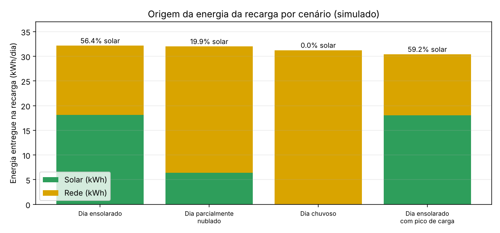
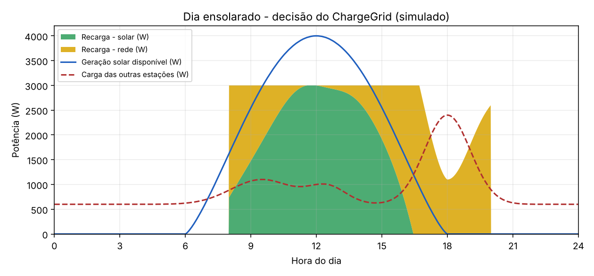
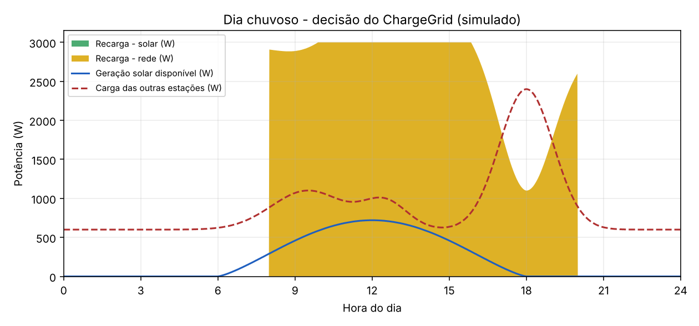

# ChargeGrid – Recarga de Veículos Elétricos Priorizando Energia Solar

### Challenge FIAP + GoodWe 2026 – Sprint 4 (Solução Final Integrada)

Automação de um posto comercial de recarga de veículos elétricos que decide, a cada ciclo, quanto entregar ao carro combinando **geração solar**, **rede elétrica** e a **carga das demais estações** do posto. O hardware (Raspberry Pi Pico + MicroPython, simulado no Wokwi) executa a decisão em tempo real; um **simulador em Python** executa a mesma lógica sobre perfis diários para gerar resultados quantitativos reprodutíveis.

---

## Equipe

| Nome | RM |
|---|---|
| Giovanna Ferreira Almeida | RM571822 |
| Lucas Bellezzo Figueiredo | RM569734 |
| Maria Luiza Vieira de Freitas | RM571535 |
| Matheus Arruda Camara Soares | RM571594 |
| Matheus Sabino da Silva Guedes | RM572907 |


- **Repositório:** https://github.com/matheusacsoares/Challenge_FIAP-GoodWe
- **Projeto Wokwi:** https://wokwi.com/projects/475584415281579009

---

## Índice

1. [Visão geral](#1-visão-geral)
2. [Arquitetura final e integração](#2-arquitetura-final-e-integração)
3. [Algoritmo de decisão](#3-algoritmo-de-decisão)
4. [Alinhamento ao desafio GoodWe](#4-alinhamento-ao-desafio-goodwe)
5. [Alinhamento às disciplinas](#5-alinhamento-às-disciplinas)
6. [Resultados quantitativos](#6-resultados-quantitativos)
7. [Resultados qualitativos](#7-resultados-qualitativos)
8. [Avaliação crítica: sustentabilidade e inovação](#8-avaliação-crítica-sustentabilidade-e-inovação)
9. [Simulado vs. real e limitações](#9-simulado-vs-real-e-limitações)
10. [Como executar](#10-como-executar)
11. [Estrutura do repositório](#11-estrutura-do-repositório)
12. [Tecnologias e referências](#12-tecnologias-e-referências)

---

## 1. Visão geral

Um posto de recarga com geração solar enfrenta três problemas ao mesmo tempo: aproveitar ao máximo a energia renovável, não sobrecarregar a conexão com a rede e não deixar o cliente sem recarga. O ChargeGrid resolve isso com uma política simples e auditável:

1. **O solar é usado primeiro**, depois de descontada a carga das outras estações.
2. **A rede completa** o que o solar não cobre.
3. **A potência só é reduzida** quando solar e rede juntos não bastam, e **nunca é bloqueada** apenas por falta de sol.
4. **O limite de importação da rede nunca é ultrapassado** (verificado por `assert` no simulador, em todos os cenários).

## 2. Arquitetura final e integração

```
        ┌────────────────────── HARDWARE (Wokwi) ──────────────────────┐
        │  LDR (geração solar)   Potenciômetro (carga outras estações) │
        │  Botão (inicia/encerra sessão)                               │
        │            └──────────────┬───────────────┘                  │
        │                  Raspberry Pi Pico (MicroPython)             │
        │                  main.py → calcularFornecimento()            │
        │          LED verde / amarelo / vermelho    Relé (energia)    │
        └──────────────────────────┬───────────────────────────────────┘
                                   │ mesma lógica de decisão
        ┌──────────────────────────▼───────────────────────────────────┐
        │  SIMULADOR (Python) – simulador.py                           │
        │  perfis de geração/carga de 24 h × 4 cenários → CSV / JSON   │
        └──────────────────────────┬───────────────────────────────────┘
                                   ▼
        gerar_graficos.py → gráficos (resultados/img) → análise (seção 6)
```

**Integração:** a função `calcular_fornecimento()` do `simulador.py` é uma cópia fiel de `calcularFornecimento()` do `main.py` do Pico, com as mesmas constantes (geração máx. 4000 W, carga máx. das outras estações 3000 W, demanda de recarga 3000 W, rede máx. 3500 W). Assim, o que se mede no simulador é o comportamento do algoritmo que roda no hardware.

| Camada | Componente | Função |
|---|---|---|
| Sensoriamento | LDR (ADC GP27) | Representa a geração solar (luz → W) |
| Sensoriamento | Potenciômetro (ADC GP26) | Representa a carga das demais estações |
| Entrada | Botão (GP5, pull-up) | Inicia/encerra a sessão de recarga |
| Decisão | Pico + MicroPython | Calcula solar/rede/estado a cada 2 s |
| Atuação | Relé (GP4) | Libera ou corta a energia de fato |
| Sinalização | LEDs (GP3, GP2, GP1) | Verde = 100 % solar · Amarelo = solar + rede · Vermelho = reduzida |
| Registro | Monitor serial | Estado, W solar/rede, % solar, tempo e Wh da sessão |
| Análise | `simulador.py` + `gerar_graficos.py` | Resultados diários por cenário |

## 3. Algoritmo de decisão

```
capacidade_total = geração_solar + limite_da_rede
sobra            = max(0, capacidade_total − carga_outras_estações)
entrega          = min(demanda_de_recarga, sobra)

solar_restante   = max(0, geração_solar − carga_outras_estações)
entrega_solar    = min(entrega, solar_restante)      # solar primeiro
entrega_rede     = entrega − entrega_solar           # rede completa

entrega < demanda   → RECARGA REDUZIDA (LED vermelho)
entrega_rede == 0   → RECARGA 100 % SOLAR (LED verde)
caso contrário      → RECARGA COMPLETA SOLAR + REDE (LED amarelo)
```

O relé liga sempre que há sessão ativa e algo a entregar, mesmo em potência reduzida.

## 4. Alinhamento ao desafio GoodWe

| Ponto do desafio | Como a solução responde |
|---|---|
| Geração, uso e armazenamento de energia renovável com monitoramento | Geração solar priorizada sobre a rede; sessão monitorada (tempo, Wh, % solar) |
| Eficiência e proteção da instalação | Limite de importação da rede respeitado em 100 % dos instantes simulados |
| Automação | Decisão contínua, sem intervenção manual, reagindo a sensores e botão |
| Compatibilidade GoodWe | Ver abaixo |

**Compatibilidade GoodWe (mapeamento conceitual, não integração implementada).** As três grandezas que o algoritmo usa (potência fotovoltaica, potência da carga e potência trocada com a rede) são as mesmas que um inversor híbrido GoodWe e seu monitoramento em nuvem (SEMS Portal) expõem. Em uma versão com equipamento real, o LDR e o potenciômetro seriam substituídos por essas leituras, e a bateria entraria como quarta fonte na mesma lógica de prioridade. **Nenhum equipamento GoodWe físico ou API foi utilizado nesta sprint.**

## 5. Alinhamento às disciplinas

- **Soluções em Energias Renováveis e Sustentáveis (SERS):** priorização do solar, métrica de % renovável por sessão, estimativa de CO₂ evitado e economia, análise de cenários de irradiação.
- **Pensamento Computacional e Automação com Python (PCAP):** decomposição em funções (leitura, cálculo, atuação, exibição), laço de automação contínuo, leitura de sensores reais de hardware, simulação e análise de dados em Python.
- A parte de COA (Arquitetura de Computadores) foi entregue separadamente pelo grupo.

## 6. Resultados quantitativos

Simulação de 24 h, passo de 1 min, com sessão de recarga ativa das 8 h às 20 h (demanda de 3 kW, equivalente a 36 kWh/dia). Dados em `resultados/resumo_cenarios.csv`.

| Cenário | Entregue (kWh) | Solar (kWh) | Rede (kWh) | % solar | % da demanda atendida | Min. em potência reduzida | Pico de importação da rede | CO₂ evitado* | Economia* |
|---|---|---|---|---|---|---|---|---|---|
| Dia ensolarado | 32,13 | 18,13 | 14,01 | 56,4 % | 89,3 % | 197 | 3500 W | 0,73 kg | R$ 16,32 |
| Parcialmente nublado | 31,98 | 6,38 | 25,60 | 19,9 % | 88,8 % | 205 | 3500 W | 0,26 kg | R$ 5,74 |
| Chuvoso | 31,22 | 0,00 | 31,22 | 0,0 % | 86,7 % | 363 | 3500 W | 0,00 kg | R$ 0,00 |
| Ensolarado + pico de carga | 30,40 | 18,00 | 12,40 | 59,2 % | 84,5 % | 206 | 3500 W | 0,72 kg | R$ 16,20 |

\* **Premissas editáveis, não medições:** fator de emissão da rede de 0,04 kg CO₂/kWh e tarifa de R$ 0,90/kWh (parâmetros no topo de `simulador.py`). Confirme o fator na fonte oficial antes de citar o número como definitivo.





## 7. Resultados qualitativos

- A recarga **nunca é bloqueada** por falta de sol: no dia chuvoso a rede sustenta a sessão (86,7 % da demanda atendida, o restante limitado pela capacidade do posto).
- A **sinalização por LEDs** deixa o estado legível sem tela: verde, amarelo e vermelho correspondem aos três regimes de operação.
- O **relé** separa "estado informado" de "energia efetivamente entregue".
- A lógica é **auditável**: poucas linhas, sem modelo opaco, reproduzível no hardware e no simulador.

## 8. Avaliação crítica: sustentabilidade e inovação

**Benefícios**
- Em dia ensolarado, mais da metade da energia da recarga vem de fonte renovável (56,4 %), sem qualquer ação do operador.
- O limite da rede é respeitado mesmo com o pico de carga das outras estações.

**Limitações**
- Mesmo em dia ensolarado só 25 min são 100 % solar: com demanda de 3 kW e o solar dividido com as outras estações, o solar raramente cobre sozinho a recarga inteira.
- Cerca de 3,3 h por dia ficam em potência reduzida, principalmente no fim da tarde, quando a geração cai e a carga das outras estações sobe. Uma bateria (ou a recarga agendada) reduziria isso e é o próximo passo natural.
- O ganho absoluto de CO₂ é pequeno (menos de 1 kg/dia) porque se trata de **um** carregador; o valor está em como o resultado escala com o número de estações.
- A decisão é reativa (usa o instante atual). Não há previsão de geração nesta sprint.

**Inovação:** priorização solar com completude pela rede e redução gradual (em vez de corte), proteção do limite de importação e um simulador que liga hardware, algoritmo e métricas de sustentabilidade em uma única lógica.

## 9. Simulado vs. real e limitações

| Elemento | Natureza |
|---|---|
| LDR, potenciômetro, botão, relé, LEDs | Componentes simulados no Wokwi; as leituras reagem ao usuário em tempo real |
| Conversão luz → W | Aproximação linear simplificada, não calibrada em painel real |
| Demanda de recarga | Constante de 3000 W no código (não há veículo conectado) |
| Perfis diários de geração e carga | Modelos sintéticos em `simulador.py`, não medições de inversor |
| Fator de CO₂ e tarifa | Premissas, ver seção 6 |
| Equipamento e API GoodWe | **Não utilizados** nesta sprint |
| Dashboard, gateway OCPP, previsão com Random Forest e assistente virtual | Não integrados a esta entrega; o Pico utilizado não tem conectividade de rede |

## 10. Como executar

**Hardware simulado:** abra o [projeto no Wokwi](https://wokwi.com/projects/475584415281579009) (ou importe `diagram.json` e `main.py`), rode, ajuste a luz do LDR e o potenciômetro e use o botão para iniciar/encerrar a sessão.

**Simulador e gráficos:**

```bash
pip install matplotlib
python simulador.py resultados
python gerar_graficos.py resultados
```

## 11. Estrutura do repositório

```
├── main.py                 # firmware MicroPython (Raspberry Pi Pico)
├── diagram.json            # circuito do Wokwi
├── simulador.py            # simulação de cenários com a mesma lógica do main.py
├── gerar_graficos.py       # gráficos do README
├── resultados/
│   ├── resumo_cenarios.csv / .json
│   ├── serie_*.csv         # séries de 1 min de cada cenário
│   └── img/                # gráficos
└── README.md
```

## 12. Tecnologias e referências

- Raspberry Pi Pico, MicroPython, Wokwi (LDR, potenciômetro, relé, botão, LEDs)
- Python 3, matplotlib, CSV/JSON
- Git / GitHub
- GoodWe Technologies: inversores híbridos e SEMS Portal (referência conceitual)
- Material das disciplinas SERS e PCAP (FIAP)
